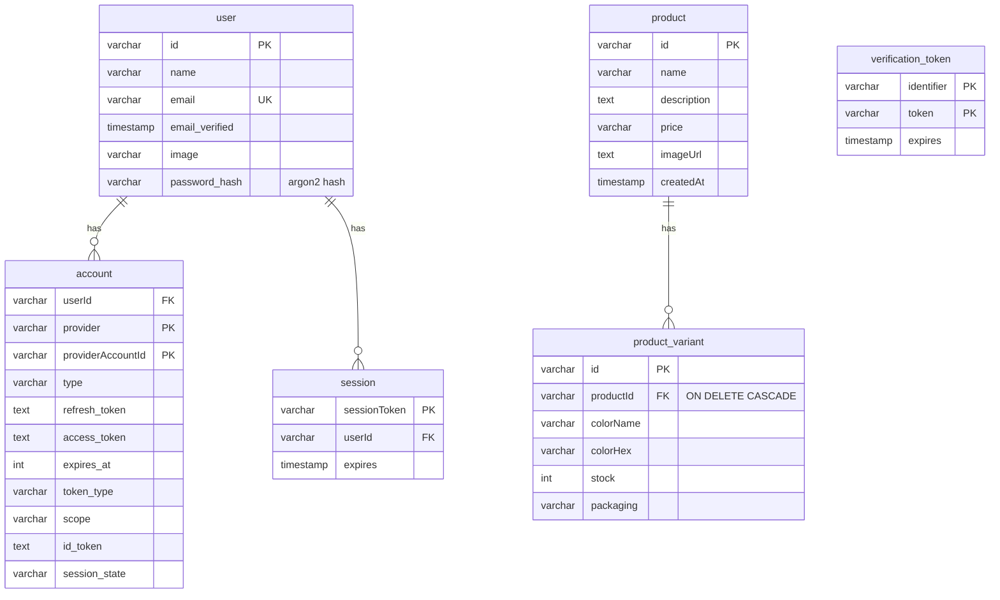

# mm_web

Quotation editor built on the [T3 Stack](https://create.t3.gg/) — Next.js 16 (App
Router), NextAuth / Auth.js (email + password), tRPC, Drizzle ORM, Tailwind CSS,
and PostgreSQL. A signed-in user browses a product catalog, selects products, and
assembles a printable quotation in a Konva-based canvas editor with PDF export.

## Tech stack

- **Next.js 16** (App Router, React Server Components, standalone output)
- **NextAuth v5 / Auth.js** — credentials (email + password) with argon2 hashing,
  JWT session strategy
- **tRPC v11** — end-to-end typesafe API, backed by TanStack React Query
- **Drizzle ORM** + **PostgreSQL** — schema, migrations, and queries
- **Konva / react-konva** + **jsPDF** — canvas editor and PDF export
- **Tailwind CSS v4**

## Architecture

```
src/
├── app/                      Next.js App Router (routes + UI)
│   ├── page.tsx              "/"  — login form (signed out) / product catalog (signed in)
│   ├── login/                "/login" standalone login page
│   ├── editor/               "/editor" Konva quotation editor + PDF export
│   ├── _components/          shared UI (nav bar, login form, product card, …)
│   └── api/                  route handlers: tRPC catch-all + NextAuth
├── server/                   server-only code
│   ├── auth/                 NextAuth config (JWT strategy, credentials provider)
│   ├── db/                   Drizzle client + schema
│   └── api/                  tRPC routers (the business layer)
├── trpc/                     tRPC client wiring (server caller + React provider)
├── lib/                      framework-agnostic helpers (localStorage selection)
└── styles/                   Tailwind entry
```

### Routes

| Route     | Auth        | Description                                            |
| --------- | ----------- | ------------------------------------------------------ |
| `/`       | public      | Login form when signed out; product catalog when in    |
| `/login`  | public      | Standalone login page                                  |
| `/editor` | signed-in   | Quotation canvas editor with undo/redo and PDF export  |

> Note: after a successful login you land on `/` (the catalog). The editor is
> reached from the nav bar / the floating "go to quotation" bar — there is no
> automatic redirect to `/editor`.

## Database schema

Two logical groups share one database:

- **Auth tables** (`user`, `account`, `session`, `verification_token`) — the
  NextAuth / Auth.js Drizzle adapter schema. `user.password_hash` (argon2)
  backs credentials login; the database also stores the verification timestamp
  in `email_verified`.
- **Catalog tables** (`product`, `product_variant`) — products shown on the home
  page, each with color/stock variants.

All tables are physically prefixed with `mm_web_` (Drizzle multi-project schema).



> `verification_token` has no foreign key (it is keyed by `identifier` + `token`)
> and so stands alone.

## Database & environments

The app uses **PostgreSQL** via Drizzle, with this split:

| Role           | Where                        | Purpose                                               |
| -------------- | ---------------------------- | ----------------------------------------------------- |
| **Production** | Supabase (prod project)      | Real app + data                                       |
| **Dev**        | Supabase (dev project/branch)| Day-to-day development — identical to prod, only data differs |
| **Test**       | Docker Postgres (ephemeral)  | SQL/ORM integration tests; migrated fresh, then discarded |

Dev and prod both run on Supabase so there are **no behavioral differences**
(connection pooling, SSL, limits) between them — only the data differs. Docker
Postgres is kept purely as a fast, throwaway database for integration tests.

The schema is identical everywhere because it comes from one source of truth —
the Drizzle migrations in `drizzle/`. Whatever database `pnpm db:migrate` points
at gets the same tables.

### Connection URLs

Two connection strings drive this (see `.env.example`):

- `DATABASE_URL` — **pooled** connection used by the running app. On Supabase this
  is the pgBouncer pooler (port 6543, `?pgbouncer=true`). The DB client sets
  `prepare: false` so pooled connections work; this is a no-op on plain Postgres.
- `DIRECT_URL` — **direct**, non-pooled connection (Supabase port 5432) used only
  for migrations and Drizzle Studio. Optional — falls back to `DATABASE_URL` when
  unset (e.g. a local Docker Postgres with no separate direct endpoint).

## Run everything with one command (Docker — test DB)

> Docker is kept as an **ephemeral test database**, not the app's primary store.
> For normal development, run the app against Supabase (see
> [Local development](#local-development)).

Requires Docker with Compose v2 (`docker compose`).

`AUTH_SECRET` is **required** — there is no committed default (it is the key that
signs/encrypts session tokens). Generate one and pass it in:

```bash
AUTH_SECRET="$(openssl rand -base64 33)" docker compose up --build
```

This will:

1. Start PostgreSQL (data persisted in the `db-data` volume).
2. Wait for the database to be healthy, then apply Drizzle migrations.
3. Start the Next.js app on http://localhost:3000 once migrations succeed.

The app opens on the **login page** (`/`). After signing in you see the **product
catalog**; open the **editor** (`/editor`) from the nav bar.

### Create a login user

The app has no public sign-up, so seed a user once the stack is running:

```bash
docker compose run --rm migrate pnpm db:seed you@company.com "your-password" "Your Name"
```

Optionally seed demo catalog products:

```bash
docker compose run --rm migrate pnpm db:seed:products
```

### Hot reload (Docker Compose Watch)

For development with hot module reload, run the `dev` service instead of `app`:

```bash
AUTH_SECRET="$(openssl rand -base64 33)" pnpm docker:dev
```

This starts Postgres, applies migrations, then boots the Next.js **dev** server
(HMR) on http://localhost:3000 and watches the project:

- **Source edits** are synced into the container and hot-reload — no rebuild.
- **Dependency changes** (`package.json` / `pnpm-lock.yaml`) or `Dockerfile`
  edits trigger an image rebuild and a service restart.

Watch requires Docker Compose v2.22+. To stop, press `Ctrl+C` (or
`pnpm docker:down` in another terminal). Tail the dev logs with
`pnpm docker:dev:logs`.

### Configuration

Environment variables read by Compose:

- `AUTH_SECRET` — **required**, no default. NextAuth signing/encryption key.
  Generate with `openssl rand -base64 33`. If missing, `docker compose up` fails
  with a clear message.
- `POSTGRES_PASSWORD` — Postgres password. Defaults to `postgres` for local dev
  only; set a strong value in production.
- `AUTH_URL` — public URL the browser uses (default `http://localhost:3000`).

## Local development

Develop against the **Supabase dev project** so your environment matches
production exactly (only the data differs).

```bash
pnpm install
# 1. Create a .env from the template and fill in the Supabase dev URLs + AUTH_SECRET
cp .env.example .env
#    - DATABASE_URL -> Supabase pooled (6543, ?pgbouncer=true)
#    - DIRECT_URL   -> Supabase direct (5432)
#    - AUTH_SECRET  -> openssl rand -base64 33
# 2. Apply migrations (uses DIRECT_URL) and seed a login user
pnpm db:migrate
pnpm db:seed you@company.com "your-password" "Your Name"
# 3. Run the dev server
pnpm dev
```

The app has no public sign-up, so `pnpm db:seed` is how you create a login user.

To create or update multiple users, prepare a UTF-8 CSV with `email` and
`password` columns. Optional columns are `name`, `alias`, `phone`, `phone_ext`,
and `cellphone`:

```csv
email,password,name,alias,phone,phone_ext,cellphone
alex@example.com,ChangeMe-123,Alex Smith,Alex,+1-555-0100,42,+1-555-0199
sam@example.com,ChangeMe-456,Sam Lee,Sam,,,
```

Then run the bulk seeder against the database configured in `.env`:

```bash
pnpm db:seed:users ./users.csv
```

Passwords are hashed with Argon2id. Existing users with a matching email are
updated; blank optional fields leave existing values unchanged. The import is
transactional, so invalid rows or database errors leave the batch unchanged.

> **Tests** use an ephemeral Docker Postgres instead of Supabase — see
> [Run everything with one command (Docker — test DB)](#run-everything-with-one-command-docker--test-db).
> `./start-database.sh` still spins up a local Postgres container for that purpose.

## Useful scripts

- `pnpm dev` — start the dev server
- `pnpm docker:dev` — run the stack in Docker with hot reload (Compose Watch)
- `pnpm docker:dev:logs` — tail the Docker dev service logs
- `pnpm build` / `pnpm start` — production build and serve
- `pnpm db:generate` — generate a migration from schema changes
- `pnpm db:migrate` — apply migrations
- `pnpm db:push` — push schema directly (dev convenience)
- `pnpm db:seed <email> <password> [name]` — create/update a login user
- `pnpm db:seed:users <csv-file>` — bulk create/update login users from CSV
- `pnpm db:seed:products` — seed demo catalog products
- `pnpm db:studio` — open Drizzle Studio
- `pnpm typecheck` — TypeScript check
- `pnpm lint` / `pnpm lint:fix` — ESLint

See `docs/docker-optimizations.md` for Docker build-performance notes.
```
