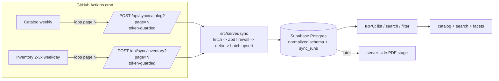

# Implementation Plan — External API ETL Sync, Custom API Layer & Supabase Migration

> Status: **Planned — not yet implemented.** This document is the agreed blueprint
> for moving the POC off mock/seed data onto a real external-API-backed pipeline.

## Problem Statement

Move the POC from demo-seeded data on a self-managed Postgres to a real pipeline:
Supabase Postgres as the store, an ETL that pulls from an external aggregator API
(no server-side filtering; full paginated reads of ~5.2k products / ~16.8k
inventory items), a defensive Zod firewall that sanitizes messy/stringified
payloads and persists only a curated field subset into an expanded normalized
schema, GitHub Actions scheduling, and a tRPC API with search (SKU + keyword) and
faceted filtering. Server-side PDF generation is a later, design-first stage.

## Requirements (gathered)

- **Supabase Postgres** (not self-managed Docker DB).
- External API: bearer/API-key header, page pagination (limit 100), **no
  query-param filtering** — fetch all pages each run; delta saves writes, not reads.
- Keep UUID PKs; add unique `external_id` (bigint) on products & variants for
  matching/delta.
- Normalized: `categories` + join (by name, product-level), product/variant images
  (kind=main|gallery), rich `product_attributes` + simple `variant_attributes`.
  **Tags as `text[]`** (aggregator has no tag standard; supports partial search).
- **Selective persistence** — store only curated fields; Zod strips the rest.
- Two cycles: catalog weekly, inventory 2–3×/weekday. Inventory updates variant
  stock by external id/sku.
- Page-per-request endpoints; GitHub Action drives the pagination loop; shared
  `src/server/sync/` module; token-guarded routes; `sync_runs` audit table.
  **Drop the demo seed.**
- Search by SKU (exact + partial) and keyword (name/description/tags); UI faceted
  filtering (color, price range, category, availability).
- **Server-side PDF generation** to be designed later (currently client-side jsPDF).

## Background (code + payload analysis)

Products/variants are already real Drizzle tables served via offset pagination in
`src/server/api/routers/product.ts`; schema is minimal. Current PDF export is
client-side (jsPDF, `src/app/editor/_components/pdf-export.ts`). DB client is
`postgres-js` (`src/server/db/index.ts`) pointed at `DATABASE_URL`.

Payload quirks confirmed from `docs/api_example.md`:

- `images` — stringified JSON object; different keys for product
  (`main_image`/`gallery_images`) vs variant
  (`variation_main_image`/`variation_gallery_images`).
- `tags` and `printing_methods` — stringified JSON arrays.
- `categories` — array-of-names on product, bare string (e.g. `"15"`) on variant
  (ambiguous/unreliable → ignore at variant level).
- `attributes` — array-of-objects on product, flat map (`{Color:"Rojo"}`) on variant.
- Prices mixed number/string (`regular_price: 0`, `sale_price: "0.00"`,
  `effective_price: "19990.00"`).
- Timestamps non-ISO: `"YYYY-MM-DD HH:mm:ss"`.
- Numeric external `id` is the stable key; `updated_at` is the delta comparator.
- Inventory items key stock to variant-level records (`parent_id` → product).
- Volumes: products `total: 5239` (53 pages), inventory `total: 16843` (169 pages).

## Architecture

**Page-per-request model:** the GitHub Action owns the pagination loop and calls a
short, timeout-safe endpoint once per page. Works on Vercel serverless and
self-hosted alike, gives natural resumability/retry, keeps each invocation small.
The shared `src/server/sync/` module does the real work so logic is
runtime-agnostic.

**Key design decisions**

- Keep existing UUID PKs; add `external_id` (bigint, unique) for matching/upsert/delta.
- Delta check short-circuits **DB writes** only (API has no server-side filtering,
  so every page is still fetched each run).
- Categories normalized and deduped **by name**, product-level only (variant
  `categories` is unreliable).
- Tags stored as `text[]` (not normalized) because the aggregator spans multiple
  suppliers with no tag standard; use `pg_trgm` for partial-match search.
- Store only a curated subset of external fields; the Zod firewall `.strip()`s the rest.

---

## Epic 0 — Supabase foundation (codebase/config only)

Epic 0 is pure plumbing — point the codebase at Supabase. No new schema, no ETL, no
feature work. Starting **fresh** on Supabase (no data migration from the old DB —
re-seed a login user instead).

### Environment roles (decided)

| Role | Where | Purpose |
|------|-------|---------|
| **Production** | Supabase (prod project) | Real app + real synced data |
| **Dev** | Supabase (dev project/branch) | Day-to-day development — identical to prod, only data differs |
| **Test** | Docker Postgres (ephemeral) | Automated SQL/ORM integration tests; migrated fresh + fixtures per run, then discarded |

Rationale: dev and prod both on Supabase means **no behavioral differences**
(pooling, SSL, connection limits) between environments — only data differs. Docker
is kept **only** as a fast, credential-free, throwaway database for integration
tests (Epics 4 & 6), so SQL queries and Drizzle integrations are tested against a
real Postgres without consuming Supabase connection limits.

One Drizzle client, one driver (`postgres-js`), one `DATABASE_URL` that varies by
environment. `prepare: false` is set globally (required for Supabase pgbouncer
transaction-mode pooling; harmless on Docker Postgres) so there is no per-env
branching in code.

- [ ] **Task 0.1:** Create the Supabase prod + dev projects/branches; capture the
  pooled (6543, pgbouncer — for the app) and direct (5432 — for migrations)
  connection strings for each. _(Done in the Supabase dashboard; user supplies the
  strings.)_ _Demo:_ `psql`/Studio connects to both.
- [ ] **Task 0.2:** Update `src/env.js` + `.env.example`: add `DIRECT_URL`
  alongside `DATABASE_URL` (app uses pooled, migrations use direct). Document the
  three roles (dev/prod = Supabase, test = Docker). _Test:_ env validation passes
  with the new vars. _Demo:_ app boots pointed at the Supabase dev project.
- [ ] **Task 0.3:** Adapt `src/server/db/index.ts` (add `prepare: false`) and
  `drizzle.config.ts` (migrations target `DIRECT_URL`). _Test:_ `pnpm db:migrate`
  runs the existing migrations fresh against Supabase dev; `pnpm db:seed` creates a
  login user. _Demo:_ app runs on Supabase with the current schema + a seeded user.
- [ ] **Task 0.4:** Repurpose Docker as the **test** DB only (not the app DB):
  keep `start-database.sh` / the compose Postgres service for ephemeral test runs;
  update the README so the "run everything" story is Supabase for dev/prod and
  Docker for tests. _Demo:_ README reflects the new roles; a test run spins up and
  tears down the Docker DB.

## Epic 1 — Schema & normalization

- [ ] **Task 1.1:** Decide and document the curated "fields we keep" subset for
  product + variant (drop `connector_id`, `company_id`, `images_locked`, dimension
  nulls, etc.). _Demo:_ a short kept-fields table in `docs/`.
- [ ] **Task 1.2:** Extend `products`/`product_variants`: `external_id` (bigint
  unique), `externalUpdatedAt`, variant stock breakdown
  (`available/local/zone/transit`), `tags text[]`, status/sku fields. _Test:_
  `pnpm db:generate` + `pnpm typecheck`. _Demo:_ Studio shows new columns.
- [ ] **Task 1.3:** Add `categories` + `product_categories`. _Test:_ migration
  applies; relations typecheck. _Demo:_ Studio shows tables.
- [ ] **Task 1.4:** Add `product_images` + `variant_images` (kind, position).
  _Demo:_ Studio shows tables.
- [ ] **Task 1.5:** Add `product_attributes` (rich) + `variant_attributes`
  (name/value). _Demo:_ Studio shows tables.
- [ ] **Task 1.6:** Add `sync_runs` audit table. _Demo:_ Studio shows table.
- [ ] **Task 1.7:** Add indexes for search/filter: btree on price/sku, GIN trigram
  (`pg_trgm`) on name/tags. _Test:_ `EXPLAIN` uses the trigram index for an `ILIKE`
  query. _Demo:_ indexed search query plan.

## Epic 2 — Zod contract firewall

- [ ] **Task 2.1:** Product Zod schema with transforms for stringified
  `images`→`{main,gallery}`, `tags`→array, `printing_methods`→array; `.strip()`
  enforcing the curated subset. _Test:_ sample product → clean output; dropped
  fields absent.
- [ ] **Task 2.2:** Normalize inconsistent shapes: `categories` (array vs string),
  `attributes` (array vs map), prices (number/string→decimal string), timestamps
  (`"YYYY-MM-DD HH:mm:ss"`→Date). Emit `{clean, warnings}`. _Test:_ malformed
  variants parse safely with warnings captured.
- [ ] **Task 2.3:** Inventory Zod schema/transform
  (`available/local/zone/transit/updated_at`, keyed by id/sku). _Test:_ sample +
  edge cases normalized.

## Epic 3 — External API client

- [ ] **Task 3.1:** Add `EXTERNAL_API_BASE_URL`/`EXTERNAL_API_TOKEN` to env; typed
  fetch client with auth header. _Test:_ correct URL/headers (mocked fetch).
- [ ] **Task 3.2:** `fetchProductsPage(page)` / `fetchInventoryPage(page)`
  returning `{items, pagination}` with retry/backoff + timeout. _Test:_ pagination
  parsing + retry behavior. _Demo:_ fetch page 1 (mock) logs `pagination`.

## Epic 4 — Sync engines (shared module `src/server/sync/`)

- [ ] **Task 4.1:** `syncCatalogPage(page)` — fetch→validate→delta short-circuit by
  `externalUpdatedAt`→batch upsert products/variants by `external_id`. _Test:_ run
  twice: insert then all-skipped.
- [ ] **Task 4.2:** Child reconciliation within catalog page — images,
  categories+join, attributes, tags. _Test:_ child rows match sample; a changed
  `updated_at` reconciles children.
- [ ] **Task 4.3:** Write `sync_runs` audit (counts:
  processed/upserted/skipped/errors) from catalog sync. _Test:_ audit row reflects
  the run.
- [ ] **Task 4.4:** `syncInventoryPage(page)` — match variants by external id/sku,
  delta-check, batch-update stock, record `sync_runs`. _Test:_ stock updates;
  unchanged items skip.

## Epic 5 — Endpoints & scheduling

- [ ] **Task 5.1:** `POST /api/sync/catalog?page=N` token-guarded (constant-time
  compare), returns page summary `{page, totalPages, processed, upserted, skipped}`.
  _Test:_ 401 wrong/no token; 200 + body valid.
- [ ] **Task 5.2:** `POST /api/sync/inventory?page=N` token-guarded. _Test:_ same
  auth + body assertions.
- [ ] **Task 5.3:** `.github/workflows/sync-catalog.yml` (weekly) GitHub Action
  looping pages via `totalPages` with retry; secrets for token + base URL. _Demo:_
  manual dispatch fills catalog on Supabase.
- [ ] **Task 5.4:** `.github/workflows/sync-inventory.yml` (weekday multi-daily)
  looping pages. _Demo:_ manual dispatch updates stock.

## Epic 6 — tRPC API: catalog, search, filtering

- [ ] **Task 6.1:** Rewire `product.list`/`byId` to join normalized tables; return
  clean typed JSON (no stringified fields). _Test:_ shape assertions. _Demo:_
  catalog renders real synced data.
- [ ] **Task 6.2:** Remove `scripts/seed-products.mjs`, its `package.json` script,
  and README references. _Test:_ `pnpm typecheck`/`lint` clean. _Demo:_ no seed
  path remains; app still works.
- [ ] **Task 6.3:** `product.search` — SKU (exact then partial) + keyword
  (name/description/tags via trigram), paginated/ranked (exact SKU > name > tag/
  description). _Test:_ exact SKU, partial SKU, keyword return expected; irrelevant
  → none. _Demo:_ search by SKU and keyword.
- [ ] **Task 6.4:** Faceted filter query — `color`, `priceMin/Max`, `category`,
  `inStock`; combinable with search + pagination; returns available facet values
  (distinct colors, categories, price bounds). _Test:_ each filter narrows;
  filters combine; facet values correct.
- [ ] **Task 6.5:** Catalog filter UI (color chips, price range, category select,
  in-stock toggle) wired to 6.4; search box wired to 6.3. _Demo:_ filter + search
  update the catalog live.

## Epic 7 — Server-side PDF generation (design-first, later)

- [ ] **Task 7.1:** Design spike (doc only, no feature code): compare approaches
  (headless Chromium render vs server jsPDF vs React-PDF), decide where quotation
  data/assets come from, output a short design doc + chosen approach. _Demo:_
  design doc reviewed.
- [ ] **Task 7.2+:** To be broken down after 7.1 is agreed (endpoint, rendering,
  asset/image handling, auth, download). Deliberately left unplanned until the spike.

---

## Open items to resolve at implementation time

- Exact curated field list (Task 1.1) and whether any dropped field is needed for
  filtering/search.
- Search ranking weights and whether fuzzy (trigram similarity) vs substring
  (`ILIKE`) for keyword (Task 6.3).
- Supabase connection pooling specifics: `prepare: false` is set globally (Task
  0.3) for pgbouncer transaction mode with `postgres-js`; confirm no prepared-
  statement reliance elsewhere surfaces during dev on Supabase.
- Server-side PDF approach (Epic 7).
